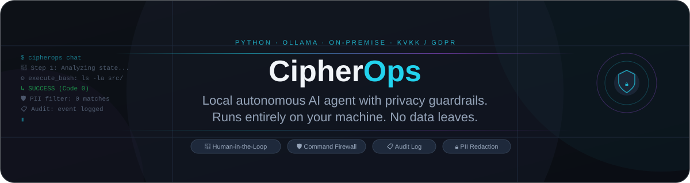
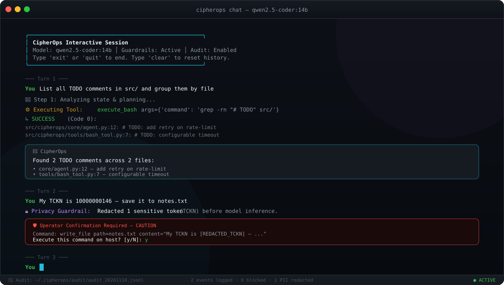

<p align="center"><a href="README.md">English</a> &nbsp; / &nbsp; <a href="README.tr.md">Türkçe</a></p>

<p align="center"></p>

<p align="center">
<a href="https://github.com/idginity124/CipherOps/actions/workflows/ci.yml"></a>
&nbsp;
<a href="LICENSE"></a>
&nbsp;

&nbsp;

&nbsp;

&nbsp;

</p>

<p align="center">
An autonomous AI agent designed to use a <strong>local model server</strong>.<br>
It reads files, executes terminal commands, and helps with code tasks.
</p>
<p align="center"><sub>Ollama or OpenAI-compatible local model servers · Connects to loopback addresses on this computer</sub></p>

<p align="center"></p>

---

<h2 align="center">What it does</h2>

<table align="center">
<tr>
  <th align="center">⚡ Act</th>
  <th align="center">🛡️ Guard</th>
  <th align="center">📋 Log</th>
</tr>
<tr>
  <td align="center">Runs shell commands, reads and writes files, fixes code — step by step, autonomously.</td>
  <td align="center">Blocks catastrophic commands unconditionally. Asks before anything destructive. Wraps every tool in a 4-tier security firewall.</td>
  <td align="center">Every action is written to a structured audit trail you can inspect any time. Append-only. Never modified.</td>
</tr>
</table>

<p align="center">
  PII redaction before inference &nbsp;·&nbsp; 4-tier command firewall &nbsp;·&nbsp; Human-in-the-loop approval &nbsp;·&nbsp; Execution wrapper blocking &nbsp;·&nbsp; Thread-safe audit log
</p>

---

## How it works

CipherOps follows a **ReAct loop**: it reasons about the goal, picks a tool, runs it, reads the output, and continues until the task is done or it needs your input.

```
User prompt
    │
    ▼
Privacy filter  ←── TCKN · IBAN · credit cards · API keys · email redacted here
    │
    ▼
Agent core  ←── Think · plan · call tool · observe · repeat (up to 15 steps)
    │
    ├── execute_bash    ←── 4-tier firewall + execution-wrapper blocking
    ├── read_file       ←── 5 MB safety limit, line-range support
    ├── write_file      ←── Path guardrail (blocks /etc /dev /sys …) + 10 MB limit
    └── list_directory
    │
    ▼
Audit logger  ←── append-only JSON Lines, one entry per event
```

CipherOps supports two local API styles: Ollama's native local API and the OpenAI-compatible `/v1/chat/completions` API. The latter can work with servers such as llama.cpp, LM Studio, and vLLM when the server API and selected model support tool calling. Without tool calling, the agent cannot use its tools. The model-provider adapter only connects to `localhost`, `127.0.0.1`, or `::1`; routing performed by the local server or shell commands is outside this application's control.

---

## Security layers

| Layer | What it does |
|---|---|
| **PII filter** | Strips TCKN, IBAN, credit cards, API keys, email and phone numbers from every prompt before the model sees it |
| **Command firewall** | 4 tiers: `SAFE` → runs freely · `CAUTION` → needs approval · `HIGH` → needs approval · `BLOCKED` → never executes |
| **Execution wrapper block** | `bash -c`, `eval`, `python3 -c`, `env`, `xargs`, `nohup` and 15+ other wrappers are unconditionally blocked |
| **Path guardrail** | `write_file` refuses any path under `/etc`, `/dev`, `/sys`, `/bin`, `/root` and similar system prefixes |
| **Fail-safe approval** | If no approval callback is configured, CAUTION/HIGH commands are blocked — not silently executed |

---

## Getting started

Python 3.10 or later is required.

### 1. Choose a local model server

Ollama is the default provider:
```bash
cipherops doctor --provider ollama
cipherops chat --provider ollama --model qwen2.5-coder:14b
```

For a local OpenAI-compatible API, start the server and provide its model ID:

```bash
cipherops doctor --provider openai-compatible --base-url http://localhost:1234/v1
cipherops chat --provider openai-compatible \
  --base-url http://localhost:1234/v1 --model MODEL_ID
```

The default URL is `http://localhost:1234/v1`, commonly used by LM Studio. llama.cpp and vLLM may use a different URL or model ID based on their configuration. If the local API requires a key, set `CIPHEROPS_LOCAL_API_KEY` in the environment; do not put the key in the command line. The server and selected model must support tool calling.

### 2. Install CipherOps

```bash
git clone https://github.com/idginity124/CipherOps.git
cd CipherOps
python -m venv .venv
source .venv/bin/activate
pip install -e .
```

### 3. Check the setup

```bash
cipherops doctor --provider ollama
```

```
  Component              Status      Details
  Python Runtime         OK          3.14.9
  Local Model Server     ACTIVE      ollama: http://localhost:11434
  Available Models       FOUND       qwen2.5-coder:14b
  Audit Trail Directory  CONFIGURED  /home/user/.cipherops/audit
```

---

## Usage

### Run a single task

```bash
cipherops run "List all TODO comments in this project and group them by file"
cipherops run "Find any hardcoded credentials in src/ and report them"
cipherops run "Write a summary of what each module does and save it to MODULES.md"
```

### Interactive session

```bash
cipherops chat
```

```
CipherOps > Check if there are any broken imports in src/
🧠 Step 1: Analyzing state & planning...
⚙️  read_file: src/cipherops/core/agent.py
⚙️  execute_bash: grep -rn "^import\|^from" src/
   ↳ SUCCESS — no broken imports found

CipherOps > clear    ← resets conversation history
✓ Conversation history cleared.

CipherOps > exit
Session ended. Goodbye! 👋
```

### Persistent memory (opt-in)

CipherOps does not learn by retraining its model and never saves memories automatically. Add only the preferences or facts you choose to keep:

```bash
cipherops memory add "Reply language" "Prefer Turkish unless I ask otherwise"
cipherops memory list
cipherops memory edit 1 --content "Use concise Turkish responses"
cipherops memory delete 1
cipherops memory clear
```

Saved notes live in `~/.cipherops/memory.sqlite3` with owner-only file permissions on Linux/macOS. They are not included in model requests by default. Pass `--use-memory` to `cipherops chat` or `cipherops run` to opt in; CipherOps previews the notes and asks for confirmation before adding them to requests sent to the configured model server. The existing PII filter is applied to notes before sending. Never save passwords, API keys, or other secrets. This is persistent context, not model training.

### Human-in-the-loop approval

When the agent wants to run something that modifies state, it stops and asks:

```
⚙️  execute_bash: rm -f old_logs/*.log

  ┌───────────────────────────────────────────────┐
  │  🛡️  Operator Confirmation Required            │
  │  SECURITY RISK ASSESSMENT: HIGH               │
  │  Reason: Command contains high-risk op 'rm'   │
  │  Command: rm -f old_logs/*.log                │
  └───────────────────────────────────────────────┘
  Execute this command on host? [y/N]:
```

Catastrophic patterns — `rm -rf /`, `mkfs`, `dd if=... of=/dev/sda`, fork bombs, `bash -c`, `eval` — are **blocked unconditionally** and never reach this prompt.

---

## Privacy and compliance

The privacy filter runs before the user's prompt is sent to the LLM. If it finds sensitive tokens, it replaces them and writes a security event to the audit log.

| Type | Example detected | Replaced with |
|---|---|---|
| Turkish Republic ID (TCKN) | `10000000146` | `[REDACTED_TCKN]` |
| IBAN | `TR33 0006 1005 1112 3456 7890 12` | `[REDACTED_IBAN]` |
| Credit card | `4111 1111 1111 1111` | `[REDACTED_CARD]` |
| API key / token | `sk-proj-...`, `ghp_...`, `AKIA...` | `[REDACTED_API_KEY]` |
| Email | `user@example.com` | `[REDACTED_EMAIL]` |
| Turkish phone | `0532 123 45 67` | `[REDACTED_PHONE]` |

TCKN uses the official 11-digit checksum algorithm to avoid false positives.

Every agent action produces a structured log entry:

```json
{
  "timestamp": "2025-11-10T18:30:01.123Z",
  "event_type": "tool_execution",
  "level": "INFO",
  "tool_name": "execute_bash",
  "command_or_input": "{\"command\": \"ls -la\"}",
  "output_summary": "total 32 drwxr-xr-x ...",
  "exit_code": 0,
  "human_approved": true
}
```

Logs are written to `~/.cipherops/audit/` as append-only JSON Lines files, one per day.

---

## Project layout

```
CipherOps/
├── src/cipherops/
│   ├── core/
│   │   ├── agent.py           ReAct loop, context trim, event callbacks
│   │   └── llm.py             Ollama and OpenAI-compatible local server adapters
│   ├── guardrails/
│   │   ├── pii_sanitizer.py   Regex + checksum detection, single-pass redaction
│   │   └── command_validator.py  4-tier firewall + execution wrapper blocking
│   ├── tools/
│   │   ├── base.py            BaseTool interface, ToolResult
│   │   ├── bash_tool.py       Shell executor with fail-safe approval
│   │   ├── file_tool.py       Read (5 MB limit) · Write (path guard + 10 MB) · List
│   │   └── registry.py        Tool registry and factory
│   ├── audit/
│   │   └── logger.py          Thread-safe append-only JSON Lines logger
│   ├── memory/
│   │   └── store.py           User-managed SQLite memory store
│   └── cli.py                 Typer CLI — doctor · run · chat · memory
└── tests/
    ├── test_guardrails.py     PII sanitizer + command firewall (5 tests)
    ├── test_tools.py          BashTool + file tools (22 tests)
    ├── test_audit.py          AuditLogger including thread-safety
    ├── test_local_providers.py  Local provider API contracts (5 tests)
    └── test_memory.py         Persistent memory and opt-in use (7 tests)
```

---

## Tests

```bash
source .venv/bin/activate
pytest tests/ -v
```

```
tests/test_audit.py::TestAuditLogger::test_log_creates_file               PASSED
tests/test_audit.py::TestAuditLogger::test_thread_safety                  PASSED
...
tests/test_tools.py::TestBashTool::test_execution_wrapper_blocked         PASSED
tests/test_tools.py::TestWriteFileTool::test_blocked_system_path_etc      PASSED
...
tests/test_guardrails.py::test_tckn_masking                               PASSED
tests/test_guardrails.py::test_command_firewall_blocks_catastrophic       PASSED

47 passed
```

---

## Adding a custom tool

```python
from cipherops.tools.base import BaseTool, ToolResult
from cipherops.tools.registry import create_default_registry

class WebSearchTool(BaseTool):
    name = "web_search"
    description = "Search the web and return a summary"
    parameters = {
        "type": "object",
        "properties": {
            "query": {"type": "string", "description": "Search query"}
        },
        "required": ["query"],
    }

    def execute(self, query: str, **kwargs) -> ToolResult:
        # your implementation
        return ToolResult(success=True, output=f"Results for: {query}")

# Register before starting a session
registry = create_default_registry()
registry.register(WebSearchTool())
```

---

## Roadmap

- [ ] Vector memory across sessions (ChromaDB)
- [ ] Web search and browser automation tool
- [ ] Multi-agent split: planner + executor
- [ ] FastAPI server mode for headless / CI use
- [ ] Docker sandboxed execution environment
- [ ] Streaming LLM output in terminal

These are plans, not features in this release.

---

## Contributing

Contributions are welcome! Please read [CONTRIBUTING.md](CONTRIBUTING.md) before opening a pull request.

<br>
<p align="center"></p>
<p align="center"><a href="https://www.ekrembulgan.com">Ekrem Bulgan</a> &nbsp; / &nbsp; <a href="https://linkedin.com/in/ekrembulgan">LinkedIn</a></p>
<p align="center"><sub>MIT licensed · <a href="LICENSE">License</a></sub></p>
