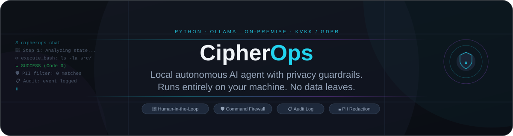

<p align="center"><a href="README.md">English</a> &nbsp; / &nbsp; <a href="README.tr.md">Türkçe</a></p>

<p align="center"></p>

<p align="center">
<a href="LICENSE"></a>
&nbsp;

&nbsp;

&nbsp;

</p>

<p align="center">Tamamen kendi bilgisayarınızda çalışan bir yapay zeka ajanı.<br>
Dosya okur, terminal komutları çalıştırır, kod düzeltir — dışarıya hiçbir şey göndermeden.</p>
<p align="center"><sub><a href="https://ollama.com">Ollama</a> üzerine kurulu · Gizlilik ve kurumsal ortamlar için tasarlandı</sub></p>

<p align="center"></p>

<h2 align="center">Ne yapar</h2>

<table align="center"><tr><th align="center">Hareket eder</th><th align="center">Korur</th><th align="center">Kayıt tutar</th></tr><tr><td align="center">Adım adım terminal komutları çalıştırır, dosya okur/yazar, kod hatalarını bulup düzeltir.</td><td align="center">Yıkıcı komutları koşulsuz engeller. Riskli her adımda sizden onay alır.</td><td align="center">Her işlem yapılandırılmış bir denetim günlüğüne yazılır, istediğiniz zaman inceleyebilirsiniz.</td></tr></table>

<p align="center">Model göndermeden önce hassas veri maskeleme · 4 kademeli komut güvenlik duvarı · İnsan onaylı yürütme</p>

## Nasıl çalışır

CipherOps bir ReAct döngüsü izler: hedefe bakar, bir araç seçer, çalıştırır, çıktıyı okur ve görev bitene ya da sizin müdahaleniz gerekene kadar devam eder.

```
Kullanıcı mesajı
    │
    ▼
Gizlilik filtresi  ←── TCKN · IBAN · kredi kartı · API anahtarı · e-posta burada maskelenir
    │
    ▼
Ajan çekirdeği  ←── Düşün · planla · araç çağır · gözlemle · tekrarla (en fazla 15 adım)
    │
    ├── execute_bash  ←── Her çalıştırmadan önce komut güvenlik duvarı devreye girer
    ├── read_file     ←── 5 MB güvenlik sınırı, satır aralığı desteği
    ├── write_file    ←── Üst dizinleri otomatik oluşturur
    └── list_directory
    │
    ▼
Denetim günlüğü  ←── Her olay için ek-tabanlı JSON Lines kaydı
```

Yerel LLM (Ollama üzerinden sunulan) tek çıkarım motorudur. OpenAI anahtarı gerekmez. Verileriniz makineden çıkmaz.

## Kurulum

Python 3.10 veya üzeri gereklidir.

### Ollama ve model kurulumu

```bash
# AMD GPU'lu Arch / CachyOS için (ROCm)
sudo pacman -S ollama-rocm
sudo systemctl enable --now ollama
ollama pull qwen2.5-coder:14b
```

NVIDIA veya yalnızca CPU için `ollama-rocm` yerine `ollama-cuda` ya da `ollama` kullanın. Ollama'da araç çağırmayı destekleyen herhangi bir model çalışır.

### CipherOps kurulumu

```bash
git clone https://github.com/idginity124/CipherOps.git
cd CipherOps
python -m venv .venv
source .venv/bin/activate
pip install -e .
```

### Kurulumu kontrol edin

```bash
cipherops doctor
```

```
  Bileşen                Durum       Detay
  Python Sürümü          OK          3.14.9
  Ollama Servisi         AKTİF       http://localhost:11434 bağlı
  Yerel Modeller         BULUNDU     qwen2.5-coder:14b
  Denetim Günlüğü        AYARLANDI   /home/kullanici/.cipherops/audit
```

## Kullanım

### Tekil görev

```bash
cipherops run "Bu projedeki tüm TODO yorumlarını bulup dosyalara göre grupla"
```

### Etkileşimli oturum

```bash
cipherops chat
```

```
CipherOps > src/ içinde kırık import var mı kontrol et
🧠 Adım 1: Durum analiz ediliyor ve plan yapılıyor...
⚙️  read_file: src/cipherops/core/agent.py
⚙️  execute_bash: python -c "import ast; ..."
   ↳ BAŞARILI — kırık import bulunamadı

CipherOps > Her aracın ne yaptığını kısaca açıklayan TOOLS.md dosyası oluştur
...
```

### İnsan onayı sistemi

Ajan durumu değiştirecek bir komut çalıştırmak istediğinde durur ve sorar:

```
⚙️  execute_bash: rm -f eski_loglar/*.log

  ┌────────────────────────────────────────┐
  │  🛡️  Operatör Onayı Gerekiyor          │
  │  Risk seviyesi: HIGH                   │
  │  Sebep: 'rm' komutu tespit edildi      │
  │  Komut: rm -f eski_loglar/*.log        │
  └────────────────────────────────────────┘
  Bu komutu çalıştırayım mı? [y/N]:
```

`rm -rf /`, `mkfs`, `dd if=... of=/dev/sda`, fork bomb gibi yıkıcı kalıplar koşulsuz engellenir ve bu ekrana asla ulaşmaz.

## Gizlilik ve uyumluluk

Gizlilik filtresi, kullanıcının mesajı modele gönderilmeden önce çalışır. Hassas veri tespit edilirse maskelenir ve denetim günlüğüne güvenlik olayı olarak yazılır.

| Tür | Tespit edilen örnek | Yerine yazılan |
|---|---|---|
| TC Kimlik No (TCKN) | `10000000146` | `[REDACTED_TCKN]` |
| IBAN | `TR33 0006 1005 1112 3456 7890 12` | `[REDACTED_IBAN]` |
| Kredi kartı | `4111 1111 1111 1111` | `[REDACTED_CARD]` |
| API anahtarı / token | `sk-proj-...`, `ghp_...`, `AKIA...` | `[REDACTED_API_KEY]` |
| E-posta | `kullanici@example.com` | `[REDACTED_EMAIL]` |
| Türk telefonu | `0532 123 45 67` | `[REDACTED_PHONE]` |

TCKN için yanlış pozitifi azaltmak amacıyla resmi 11 haneli checksum algoritması kullanılır.

Her ajan eylemi yapılandırılmış bir kayıt üretir:

```json
{
  "timestamp": "2025-11-10T18:30:01.123Z",
  "event_type": "tool_execution",
  "level": "INFO",
  "tool_name": "execute_bash",
  "command_or_input": "{\"command\": \"ls -la\"}",
  "output_summary": "total 32 drwxr-xr-x ...",
  "exit_code": 0,
  "human_approved": true
}
```

Günlükler `~/.cipherops/audit/` dizinine günlük dosyalar hâlinde, ek-tabanlı JSON Lines formatında yazılır.

## Proje yapısı

```
CipherOps/
├── src/cipherops/
│   ├── core/
│   │   ├── agent.py           ReAct döngüsü, iterasyon kontrolü, olay geri çağırmaları
│   │   └── llm.py             Ollama HTTP istemcisi, araç çağrısı ayrıştırma
│   ├── guardrails/
│   │   ├── pii_sanitizer.py   Regex + checksum tespiti ve maskeleme
│   │   └── command_validator.py  4 kademeli güvenlik duvarı, engellenen kalıp listesi
│   ├── tools/
│   │   ├── base.py            BaseTool arayüzü, ToolResult
│   │   ├── bash_tool.py       Onay mekanizmalı shell yürütücü
│   │   ├── file_tool.py       Okuma, yazma, dizin listeleme
│   │   └── registry.py        Araç kaydı ve fabrika
│   ├── audit/
│   │   └── logger.py          Thread-safe ek-tabanlı JSON Lines günlükçü
│   └── cli.py                 Typer CLI — doctor, run, chat
└── tests/
    └── test_guardrails.py     Gizlilik ve komut güvenlik duvarı için 5 birim testi
```

## Testler

```bash
source .venv/bin/activate
pytest tests/ -v
```

```
tests/test_guardrails.py::test_tckn_masking                                PASSED
tests/test_guardrails.py::test_iban_masking                                PASSED
tests/test_guardrails.py::test_api_key_masking                             PASSED
tests/test_guardrails.py::test_command_firewall_blocks_catastrophic        PASSED
tests/test_guardrails.py::test_command_firewall_classifies_safe_and_caution PASSED

5 passed in 0.01s
```

## Özel araç ekleme

```python
from cipherops.tools.base import BaseTool, ToolResult

class WebAramaTool(BaseTool):
    name = "web_search"
    description = "İnternette ara ve sonuçların özetini döndür"
    parameters = {
        "type": "object",
        "properties": {
            "query": {"type": "string", "description": "Arama sorgusu"}
        },
        "required": ["query"],
    }

    def execute(self, query: str, **kwargs) -> ToolResult:
        # kendi implementasyonunuz
        return ToolResult(success=True, output=f"Sonuçlar: {query}")
```

Oturum başlamadan önce kaydedin:

```python
registry = create_default_registry()
registry.register(WebAramaTool())
```

## Planlananlar

- Oturumlar arası vektör hafızası (ChromaDB)
- Web arama ve tarayıcı otomasyon aracı
- Çok ajanlı mimari: planlayıcı + yürütücü ayrımı
- Headless / CI kullanımı için FastAPI sunucu modu
- Docker sandboxed yürütme ortamı

Bunlar bu sürümdeki özellikler değil, plandakiler.

<br>
<p align="center"></p>
<p align="center"><a href="https://www.ekrembulgan.com">Ekrem Bulgan</a> &nbsp; / &nbsp; <a href="https://linkedin.com/in/ekrembulgan">LinkedIn</a></p>
<p align="center"><sub>MIT lisanslı · <a href="LICENSE">Lisans</a></sub></p>
